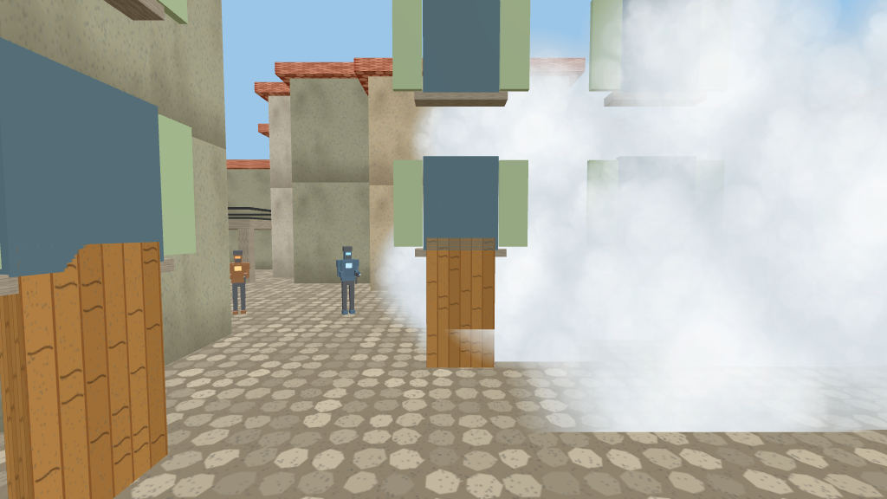
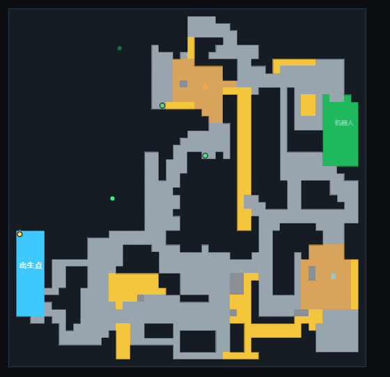

# STEEL YARD · 意大利小镇

用 **Three.js + 原生 JavaScript** 写的 3D 第一人称射击游戏。
地图按俯视雷达图生成（黑=墙、白=一层、黄=二层平台、绿=机器人出生点、蓝=玩家出生点），
建筑是意大利小镇风格（灰泥墙 + 百叶窗 + 陶瓦屋顶 + 石砌墙裙），带手雷 / 烟雾弹 / C4 等玩法。
不需要安装依赖、不需要联网、不需要构建工具，双击就能玩。





---

## 一、怎么运行

双击 `启动游戏.bat`，或双击 `index.html`；用 VSCode 打开文件夹按 `F5` 也行（可打断点）。
鼠标锁定不生效时用 `启动本地服务器.bat`。浏览器要求 Chrome / Edge。

---

## 二、操作

| 按键 | 功能 |
| --- | --- |
| `W` `A` `S` `D` | 移动（前进时自动疾跑） |
| 鼠标 | 转动视角 |
| `空格` | 跳跃（**跳蹲能跳更高**：蹲着起跳，或起跳后 0.35 秒内按下蹲） |
| **`Shift` / `Ctrl`** | **下蹲**（`C` 切换） |
| 鼠标左键 | 射击 / 投掷 / 下包 |
| 鼠标右键 | 机瞄、开镜、霰弹枪聚焦射击 |
| `R` | 换弹 |
| `F` | **检视武器**（枪和刀都有，检视中射击会立刻打断并开火） |
| `1` / `3` | 主武器 / 匕首 |
| `4` | **破片手雷** |
| `5` | **C4 炸弹** |
| `E` | **烟雾弹** |
| `Q` | 飞行开关（需在设置里勾选"允许飞行"） |
| `Esc` | 暂停 / 设置 |

---

## 三、地图

50 × 50 格、每格 2 米（100m × 100m），字符数据在 `src/world.js` 的 `MAP` 里：

| 字符 | 含义 |
| --- | --- |
| `#` | 实心建筑（自动生成窗户 / 百叶窗 / 门 / 招牌 / 陶瓦屋顶，屋顶可站人） |
| `.` | 一层地面 |
| `2` | 二层平台（地面上的台子，下面可以走人） |
| `3` | **建筑顶上的二层天桥**（下面是实心墙，上面可以走） |
| `A` / `B` | 包点地面 |
| `P` / `T` | 玩家 / 机器人出生点 |
| `o w c p` | 木箱 / 矮墙 / 石柱 / 花坛 |

**本次地图调整**

- 你标注的两处紫色框道路已经**加宽**（西侧走廊拓到 5~6 格宽，南侧通道打通 4 格）。
- 中间新增一条**长条形二层天桥**（雷达图上的竖直黄条），从 A 区一直连到底部城区。
- 建筑不再只有居民楼：会生成 **至理楼 / 至知楼 / 至善楼 / 自动化学院 / 机械学院 / 理学院 /
  体育部 / 健身房 / 厕所 / 勇哥小火锅 / 精小何 / 杂货铺 / 奶茶店 / 咖啡 / 银行 / 医疗站 / 旅馆**，
  **每种招牌最多出现一栋**，并且外观会体现功能：机械学院墙上有齿轮、自动化学院有电机、
  理学院墙上写着高斯公式、体育部和健身房挂杠铃、火锅店和精小何挂红灯笼、医疗站是绿十字。
  **如果招牌位置会被别的墙挡住，程序会自动跳过不挂**。
- 窗户的**窗台和牌匾现在都有实体**，跳上去可以站住，不会穿模。
- 栏杆去掉了会"突起"的立柱，只保留横向栏板。
- 道具（遮阳伞等）会自动避开楼梯，不会压在台阶上。

---

## 四、武器

| 武器 | 弹匣 | 移速 | 说明 |
| --- | --- | --- | --- |
| KX-7 突击步枪 | 42 | 80 | 右键机瞄：散布 ×0.34，移速 -10%，机瞄时隐藏枪身 |
| M-90 狙击枪 | 15 | 60 | 单发 **230**、爆头 4 倍；**射击间隔 0.44 秒**（加快约 40%），右键开镜 |
| M-249 机枪 | 150 | 60 | 右键机瞄：后坐力 -80%、移速 -40% |
| SPAS-12 霰弹枪 | 18 | 90 | 左键 **15 颗弹丸 × 20 伤害**，射速加快 40%；**右键"聚焦射击"只打 6 颗但散布 -70%** |
| 战术匕首（3） | — | 150 | 一刀毙命，攻击时没有枪口火光 |
| 破片手雷（4） | **无限** | — | 掷出 2.6 秒后爆炸：**中心 120 / 边缘 60**，向外递减到 0 |
| 烟雾弹（E） | **无限** | — | 落地生成半径 6 米的**灰白浓烟**，持续 18 秒；机器人看不穿，你在烟里也看不见周围 |
| C4 炸弹（5） | — | — | 只能在 A / B 包点**长按左键 4 秒**下包，60 秒后爆炸 |

所有枪械**爆头都是躯干伤害的 4 倍**，命中时机器人**头顶会飘出伤害数字**（0.5 秒后消失，爆头为金色）。

击杀机器人 **+50 分**（爆头 +75 分），C4 成功引爆 +1000 分。

> 手雷 / 烟雾弹 / C4 / 匕首都是**常驻装备**：不管你选的是步枪、狙击枪还是别的，
> 按 `4` / `E` / `5` / `3` 都能随时切出来；手雷和烟雾弹是**无限投掷**。

### 手雷与烟雾的互动

手雷在烟雾里爆炸会让**烟雾消散 2 秒**，之后如果 18 秒没到会自动恢复（这个机制已实现）。

### C4 规则

- 切出 C4 后，只有站在 **A / B 包点**里长按左键 4 秒才能安放（屏幕中间有下包进度条）。
- 安放后**所有机器人都会知道你的位置并赶过来**。
- 60 秒后爆炸：**中心 200 伤害**，半径 50 米（约半张地图）向外递减到 0，你要赶紧跑。
- **你在爆炸前阵亡，C4 会直接消失**，不会爆炸；爆炸或消失前不能放第二颗。
- 成功引爆 **+1000 分**。

---

## 五、机器人

数量上限在暂停菜单调整（默认 8，2~20），被消灭后在绿色出生点补位。
分 8 个小队巡逻，发现玩家后整队包夹并呼叫附近小队；**看不见你就不会开枪**（烟雾能断视线）。

| 类型 | 攻击间隔 | 单次伤害 | 移速 | 血量 | 外观 |
| --- | --- | --- | --- | --- | --- |
| 冲锋兵 | 0.45 秒 | 4 | 5.3 | 90 | 橙色瘦身、双刃 |
| 步枪兵 | 1.30 秒 | 4×3 | 4.1 | 130 | 蓝色、步枪 |
| 重装兵 | 2.20 秒 | 6×6 | 2.9 | 250 | 灰色重甲 |
| 狙击手 | 3.40 秒 | 42 | 3.1 | 100 | 紫色长枪管，开火前有激光预警 |

规律：攻击越快伤害越低。机器人用**人形士兵**造型（头盔 + 防弹衣 + 双手持枪 + 双腿），
**每种兵拿的枪都不一样**：冲锋兵拿冲锋枪、步枪兵拿步枪、重装兵扛机枪、狙击手拿带瞄准镜的狙击枪；
模型整体**收窄 30%**。

---

## 六、画面与手感

- **转向**：快速甩枪时会自动提高跟随速度，避免"跟不上→突然追上来"的卡顿感；
  暂停菜单里的「转向平滑」可以调（0 最跟手 ~ 1 最顺滑）。
- **飞行**：设置里勾选「允许飞行」后，游戏里按 `Q` 切换；按住空格持续上升，松开缓慢下降；
  屋顶有独立碰撞体，飞上去不会穿模。
- 其它设置：鼠标灵敏度、音量、FOV、机器人数量、小地图显示机器人、低配模式（关阴影）。

---

## 七、文件结构

```
fps-game/
├─ index.html           # 页面 + HUD + 选枪界面
├─ css/style.css        # 界面样式
├─ src/
│  ├─ utils.js          # 数学工具、程序化贴图、招牌贴图、AABB 碰撞
│  ├─ audio.js          # WebAudio 合成音效
│  ├─ world.js          # ★ 地图 / 建筑立面与招牌 / 自动二层平台与楼梯 / 道具 / 出生点 / 巡逻路线
│  ├─ nav.js            # ★ 导航网格 + A* 寻路 + 连通性自检
│  ├─ effects.js        # 火光、曳光弹、火花、弹孔、爆炸、头顶伤害数字
│  ├─ player.js         # 玩家：平滑转向 / 移动 / 跳跃 / 跳蹲 / 下蹲 / 飞行 / 复活
│  ├─ weapon.js         # ★ 武器：模型、射击、机瞄开镜、检视动画、投掷与下包
│  ├─ gadgets.js        # ★ 手雷 / 烟雾弹 / C4 的逻辑与爆炸伤害
│  ├─ enemies.js        # ★ 4 种机器人 + 小队系统 + 烟雾遮挡视线
│  ├─ pickups.js        # 道具刷新
│  ├─ minimap.js        # 雷达
│  ├─ hud.js            # HUD（含得分、装备栏、C4 倒计时、下包进度）
│  └─ main.js           # 主循环 / 状态机 / 输入 / 设置
├─ vendor/three.min.js  # Three.js r136（离线）
├─ 启动游戏.bat / 启动本地服务器.bat
└─ .vscode/launch.json
```

---

## 八、调试参数（写在网址后面）

| 参数 | 作用 |
| --- | --- |
| `?practice=1` | 练习模式（不刷机器人） |
| `?auto=1` | 跳过菜单与选枪直接开始 |
| `?lite=1` | 低配模式（关阴影） |
| `?fly=1` | 直接开启飞行权限 |
| `?spawn=列,行[,高度]&yaw=角度` | 出生点换到指定格子（截图 / 测试） |

---

## 九、改地图

改 `src/world.js` 顶部的 `MAP` 字符画即可，保存刷新后建筑、窗户、招牌、屋顶、二层平台和楼梯都会重新生成：

```js
'####################...AAA######..###222222....###', // 7
//  # 墙      . 一层地面      A 包点      2 二层平台   3 墙顶天桥
```

道具位置在同文件的 `PROPS` 数组；被道具堵死通道时，导航网格会在控制台给出警告（F12 查看）。
